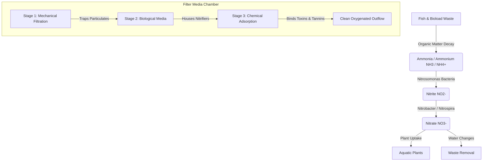

# 🐠 Aquarium Filter Simulator

[](https://github.com/gouvkimsea/aquarium-filter-sim)
[](LICENSE)
[](https://github.com/gouvkimsea/aquarium-filter-sim)
[](https://github.com/gouvkimsea/aquarium-filter-sim/pulls)

> An interactive, real-time aquatic ecosystem simulator designed to model fluid dynamics, multi-stage filtration mechanisms (mechanical, biological, and chemical), and the biochemical nitrogen cycle in closed aquatic environments.

---

## 📌 Table of Contents

- [Overview](#-overview)
- [Key Features](#-key-features)
- [Filtration & Ecological Model](#-filtration--ecological-model)
  - [1. Mechanical Filtration](#1-mechanical-filtration)
  - [2. Biological Filtration & Nitrogen Cycle](#2-biological-filtration--nitrogen-cycle)
  - [3. Chemical Filtration](#3-chemical-filtration)
  - [4. Tank Water Parameters](#4-tank-water-parameters)
- [Supported Filter Types](#-supported-filter-types)
- [Quick Start](#-quick-start)
- [Project Structure](#-project-structure)
- [Roadmap](#-roadmap)
- [Contributing](#-contributing)
- [License & Author](#-license--author)

---

## 🌊 Overview

Maintaining a healthy aquatic habitat requires a delicate equilibrium between bioload and filtration capacity. The **Aquarium Filter Simulator** simulates the physics and biochemistry of aquarium filtration systems. Users can configure tank dimensions, simulate livestock waste production, observe bacterial colony establishment, test various filter media configurations, and visualize water chemistry dynamics over time.

Whether you are an aquarist designing the optimal canister filtration flow, a student learning the nitrogen cycle, or a developer simulating ecological fluid systems, this simulator provides real-time mathematical feedback and visual analytics.

---

## ✨ Key Features

- **Interactive 3D CAD Viewport & Gizmos**: Full Three.js & React Three Fiber desktop-first CAD editor with orbit/pan/zoom, perspective/isometric/orthographic camera presets, and interactive 3D translation/rotation/scale gizmos (`TransformControls`).
- **Object Selection & Outlining**: Direct viewport mesh raycasting with selection highlight boxes, floating identity badges, and synchronised tree hierarchy outliner.
- **Bi-Directional Property Inspector**: Live synchronization between 3D viewport manipulations and the CAD properties panel (real-time position, Euler rotation in degrees, and millimeter/inch dimensions).
- **Configurable Grid Snapping**: Built-in translation and rotation angle snapping (e.g., 0.1m, 15° steps) with quick keyboard toggles (`X`).
- **Object Locking & Visibility**: Prevent accidental manipulation or raycast selection of locked or hidden scene objects (such as the container frame or delicate baffles).
- **History & Object Lifecycle**: Full Undo/Redo stack (`Ctrl+Z`, `Ctrl+Y`) supporting object creation, duplication (`Ctrl+D`), transformations, and deletion.
- **Real-Time Nitrogen Cycle Dynamics**: Precise modeling of organic waste decay into Total Ammonia Nitrogen ($NH_3/NH_4^+$), conversion to Nitrite ($NO_2^-$) by *Nitrosomonas*, and oxidation into Nitrate ($NO_3^-$) by *Nitrobacter* / *Nitrospira*.
- **Multi-Stage Filter Media Stack**: Layer coarse, medium, and fine mechanical pads, ceramic bio-rings/matrix, and chemical adsorbents (activated carbon, resins, Purigen).
- **Media Degradation & Flow Resistance**: Simulates debris clogging over time, causing decreased flow rate (GPH/LPH), bypass channeling, and head pressure changes.
- **Dynamic Water Parameters**: Real-time tracking of pH, water temperature, dissolved oxygen ($DO$), general hardness ($GH$), and carbonate hardness ($KH$).
- **Interactive Maintenance Tools**: Perform water changes (partial/complete), squeeze/rinse filter sponges, recharge chemical resin, and vacuum the substrate.
- **Bioload & Feeding Profiles**: Simulate varying livestock counts, feeding quantities, decay of uneaten food, and live plant nutrient absorption.
- **Telemetry & Visualization**: Real-time charts showing chemical concentration curves, filter saturation levels, and water clarity indices.

---

## 🔬 Filtration & Ecological Model



### 1. Mechanical Filtration
- **Coarse Sponge / Filter Floss**: Captures suspended particulate matter, uneaten food, and fish waste.
- **Clogging Dynamics**: Trapped particulate accumulation decreases effective pore size, reducing turnover rate and prompting maintenance alerts.

### 2. Biological Filtration & Nitrogen Cycle
- **Nitrification Kinetics**: Bacterial growth rates are modeled using Monod kinetic equations dependent on substrate availability (Ammonia and Nitrite), dissolved oxygen, and temperature:
  $$\mu = \mu_{\max} \frac{S}{K_s + S}$$
- **Free Ammonia vs Ammonium**: Dynamic equilibrium calculation based on pH and temperature:
  $$NH_3 = \frac{\text{Total Ammonia}}{1 + 10^{(pK_a - \text{pH})}}$$

### 3. Chemical Filtration
- **Activated Carbon & Synthetic Resins**: Adsorbs dissolved organic compounds (DOC), discoloration (tannins), medications, and odors.
- **Adsorption Capacity**: Langmuir isotherm modeling adsorption limit and media exhaustion over operational cycles.

### 4. Tank Water Parameters
- **Temperature & Oxygen Solubility**: Higher temperatures decrease dissolved oxygen saturation, influencing bacterial metabolism and livestock respiration.
- **Buffer System ($KH$)**: Carbonate hardness buffers against pH drops caused by nitric acid production during nitrification.

---

## 🛠 Supported Filter Types

| Filter Type | Typical Flow (GPH) | Biological Capacity | Mechanical Efficiency | Best Suited For |
| :--- | :--- | :--- | :--- | :--- |
| **Hang-On-Back (HOB)** | 50 – 500 GPH | Moderate | High (Cartridge / Sponge) | Small to medium freshwater tanks |
| **Canister Filter** | 150 – 1,200 GPH | Very High | Excellent (Multi-basket) | Planted, high-tech & large aquariums |
| **Sponge Filter** | 20 – 100 GPH | High | Low - Moderate | Shrimp tanks, fry breeding & quarantine |
| **Sump System** | 500 – 3,000+ GPH | Maximum | Customizable (Filter socks) | Large predator setups & marine reefs |
| **Internal Filter** | 30 – 200 GPH | Low - Moderate | Good | Nano aquariums & supplemental flow |

---

## 🚀 Quick Start

### Prerequisites
- Modern Web Browser (Chrome, Firefox, Safari, Edge)
- Git installed on your local machine

### Installation & Run

1. **Clone the repository**:
   ```bash
   git clone https://github.com/gouvkimsea/aquarium-filter-sim.git
   cd aquarium-filter-sim
   ```

2. **Install dependencies**:
   ```bash
   npm install
   ```

3. **Start the local development server**:
   ```bash
   npm run dev
   ```
   Open your browser to [http://localhost:5173](http://localhost:5173).

4. **Production Build**:
   ```bash
   npm run build
   ```

---

## 📂 Project Structure

```text
aquarium-filter-sim/
├── README.md                           # Project documentation & scientific model
├── LICENSE                             # MIT License
├── package.json                        # Dependencies & scripts (React, Three.js, R3F)
├── tsconfig.json                       # TypeScript project references
├── vite.config.ts                      # Vite build & plugin configuration
├── index.html                          # HTML shell & font definitions
└── src/
    ├── main.tsx                        # Application entry point
    ├── App.tsx                         # Core application shell & CAD layout
    ├── index.css                       # Global design system tokens & base reset
    ├── App.css                         # 3D viewport, glassmorphic HUD & inspector styling
    ├── components/
    │   ├── canvas/
    │   │   ├── AquariumViewport.tsx    # R3F Canvas, OrbitControls & transform HUD
    │   │   ├── Scene.tsx               # 3D scene meshes, container, water, and highlights
    │   │   ├── TransformGizmo.tsx      # Interactive 3D translation/rotation/scale handles
    │   │   └── EnvironmentLighting.tsx # Curated lighting presets
    │   ├── sidebar/
    │   │   ├── LeftSidebar.tsx         # Component library & scene outliner tree
    │   │   └── RightSidebar.tsx        # Object inspector (Position, Rotation, Dimensions)
    │   ├── toolbar/
    │   │   └── TopToolbar.tsx          # CAD actions, undo/redo, transform modes, snapping
    │   └── statusbar/
    │       └── CADStatusBar.tsx        # Selection readout, tool badges, dimensions
    ├── context/
    │   └── EditorContext.tsx           # State management, history stack & shortcuts
    └── types/
        └── editor.ts                   # Core data models for scene objects & editor state
```

---

## 🗺 Roadmap

- [x] Initial project design & scientific architecture specification
- [x] Desktop-first CAD interface layout (Toolbars, Sidebars, Viewport, Status Bar)
- [x] Realistic 3D viewport with glass filter container & studio lighting
- [x] Complete 3D object interaction system (Selection, Gizmos, Snapping, Undo/Redo)
- [ ] Core numerical simulation engine (Ammonia $\to$ Nitrite $\to$ Nitrate)
- [ ] Multi-stage filter media hydraulics & flow velocity simulation
- [ ] Warning triggers (Ammonia spikes, oxygen depletion, filter overflows)
- [ ] Exportable telemetry data (CSV / JSON log export)
- [ ] Interactive UI with real-time parameter sliders (temp, bioload, filter flow)
- [ ] Multiple filter configuration presets (HOB, Canister, Sponge, Sump)
- [ ] Warning triggers (Ammonia spikes, oxygen depletion, filter overflows)
- [ ] Exportable telemetry data (CSV / JSON log export)
- [ ] 2D/3D visual cross-section of filter chamber water flow

---

## 🤝 Contributing

Contributions, issues, and feature requests are welcome!

1. Fork the Project
2. Create your Feature Branch (`git checkout -b feature/AmazingFeature`)
3. Commit your Changes (`git commit -m 'Add some AmazingFeature'`)
4. Push to the Branch (`git push origin feature/AmazingFeature`)
5. Open a Pull Request

---

## 📄 License & Author

Distributed under the **MIT License**. See `LICENSE` for more information.

Created by **[Gouv Kimsea](https://github.com/gouvkimsea)**.  
Feedback or inquiries? Feel free to open an issue or connect on [GitHub](https://github.com/gouvkimsea).
