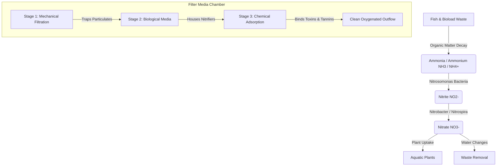
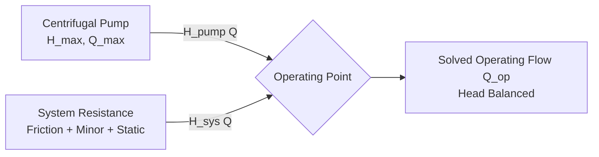
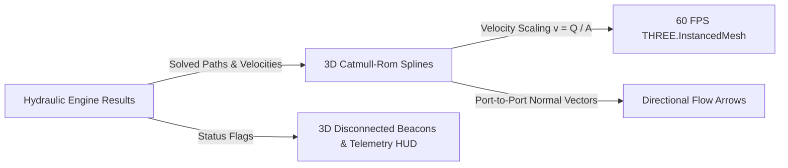

# 🐠 Aquarium Filter Simulator

[](https://github.com/gouvkimsea/aquarium-filter-sim)
[](LICENSE)
[](https://github.com/gouvkimsea/aquarium-filter-sim)
[](https://github.com/gouvkimsea/aquarium-filter-sim/pulls)

> An interactive, real-time aquatic ecosystem simulator designed to model fluid dynamics, multi-stage filtration mechanisms (mechanical, biological, and chemical), and the biochemical nitrogen cycle in closed aquatic environments.

---

## 📌 Table of Contents

- [Overview](#-overview)
- [Key Features](#-key-features)
- [Filtration & Ecological Model](#-filtration--ecological-model)
  - [1. Mechanical Filtration](#1-mechanical-filtration)
  - [2. Biological Filtration & Nitrogen Cycle](#2-biological-filtration--nitrogen-cycle)
  - [3. Chemical Filtration](#3-chemical-filtration)
  - [4. Tank Water Parameters](#4-tank-water-parameters)
- [Supported Filter Types](#-supported-filter-types)
- [Hydraulic Simulation Engine](#-hydraulic-simulation-engine)
  - [Governing Equations & Physics](#governing-equations--physics)
  - [Assumptions & Engineering Limitations](#assumptions--engineering-limitations)
  - [Supported Topologies & Failure Diagnostics](#supported-topologies--failure-diagnostics)
- [Quick Start](#-quick-start)
- [Project Structure](#-project-structure)
- [Roadmap](#-roadmap)
- [Contributing](#-contributing)
- [License & Author](#-license--author)

---

## 🌊 Overview

Maintaining a healthy aquatic habitat requires a delicate equilibrium between bioload and filtration capacity. The **Aquarium Filter Simulator** simulates the physics and biochemistry of aquarium filtration systems. Users can configure tank dimensions, simulate livestock waste production, observe bacterial colony establishment, test various filter media configurations, and visualize water chemistry dynamics over time.

Whether you are an aquarist designing the optimal canister filtration flow, a student learning the nitrogen cycle, or a developer simulating ecological fluid systems, this simulator provides real-time mathematical feedback and visual analytics.

---

- **Testable 1D Hydraulic Simulation Module**:
  - **Decoupled Architecture**: Standalone, headless TypeScript physics engine completely independent of React component rendering.
  - **Graph-Based Flow Path Tracing**: Traverses component objects and connection graph edges to map pump suction, discharge, pipes, elbows, media blocks, and return outlets.
  - **Darcy-Weisbach Friction & Minor Losses**: Calculates velocity, Reynolds numbers, Swamee-Jain Colebrook friction factors, and fitting resistance ($K$-factors).
  - **Centrifugal Pump Curve & Operating Point Solver**: Intersects the pump head-capacity curve $H(Q) = H_{max} (1 - (Q/Q_{max})^2)$ with system dynamic head curve to find true operating flow $Q_{op}$.
  - **Static Lift & Dead-Head Detection**: Correctly identifies when static elevation head $H_{static} \ge H_{max}$, stalling pump flow to $0\text{ L/h}$.
  - **Symmetric & Asymmetric Parallel Branches**: Balances head loss across parallel pipe splits while strictly conserving total mass ($Q_{total} = \sum Q_i$).
  - **Honest Diagnostics**: Flags disconnected paths, dead ends, missing pumps, and unsupported multi-pump mesh loops as explicit un-solved states rather than inventing fictional flow numbers.
  - **Structured Assumptions & Illustrative Estimates**: Flags outputs as illustrative estimates when laboratory pump dyno curves are unavailable and provides full engineering assumptions.
- **Local Project Persistence & File Export System**:
  - **Versioned Project JSON Schema (`schemaVersion: 1`)**: Complete state preservation including container dimensions, component definitions, instance IDs, 3D transforms, connection graph edges, fluid simulation state, and custom component parameters.
  - **Browser IndexedDB Storage**: High-capacity local persistence using dual object stores (`projects` and `appState`), with seamless fallback to `localStorage`.
  - **CAD Project Actions**:
    - **New Project**: Clean canvas initialization with unsaved changes verification.
    - **Save (`Ctrl+S`)**: Instant one-click persistence to IndexedDB with visual checkmark feedback.
    - **Save As...**: Name, describe, and branch designs into discrete project records.
    - **Open Project Library...**: Interactive modal with project cards, timestamps, object counts, connection counts, one-click load, disk export, and project deletion.
    - **Export Project File**: Standalone `.aquasim` and `.json` file downloads for sharing or archiving.
    - **Import Project File**: Instant drag-and-drop or file-picker import with thorough structural schema validation.
  - **Schema Validation & Migration Engine**:
    - Robust validator checking component geometry, parameters, and port connection integrity.
    - Automatic migration of legacy unversioned project files into modern versioned format.
    - Graceful error recovery: safely heals corrupted numerical dimensions ($NaN$ recovery) and flags missing components without crashing the application.
  - **Unsaved Changes Protection**:
    - Project status pill in top toolbar indicating unsaved edits (`*`).
    - CAD warning dialog prompting *Save & Continue*, *Discard & Continue*, or *Cancel*.
    - Browser `beforeunload` guard preventing accidental tab closing or page refresh.
  - **Automated Verification Test Suite**: Comprehensive headless test suite (`npm test`) covering 35 assertions on serialization, deserialization, connection stability, corruption healing, and undo/redo isolation.
- **Filter Plumbing & Component Connection System**:
  - **Named Connection Ports**: Inlets, outlets, suction couplings, discharge nozzles, and pipe sockets with authentic diameters and 3D normal vectors.
  - **Magnetic Proximity Snapping**: Automatic endpoint snapping when dragging compatible fittings within proximity threshold.
  - **Dynamic Plumbing Realignment**: Connected straight pipes and flexible hoses dynamically stretch and rotate to stay anchored when adjacent components move.
  - **Topological Graph Model**: Edge graph (`edge_${fromComp}:${fromPort}__${toComp}:${toPort}`) tracking flow chains, open ports, and orphan connections.
- **Custom Filter Geometry & Chamber Editing**:
  - **Precision Millimeter/Centimeter Sizing**: Configure filter container width, height, and depth directly in millimeters, centimeters, or inches with real-time conversion and strict boundary validation.
  - **Dynamic Geometry Recalculation**: Bottom base plate, front wall, rear wall, side walls, top rim flanges, and corner silicone seals automatically re-dimension without corrupting or deleting internal media.
  - **Multi-Mode Container Inspection**:
    - *Transparent*: Crystal-clear cast acrylic basin with high transmission and subtle refraction.
    - *Opaque*: Solid industrial slate polymer engineering enclosure with crisp chamfers.
    - *Cutaway*: Technical CAD section view with lowered front sill and illuminated cross-section cut edge for visual inspection of media beds and flow channels.
  - **Real-Time Chamber Analysis & Usable Volume**:
    - Automatic calculation of usable working fluid volume (accounting for 85% fill level and wall thickness) in Liters and Gallons.
    - Step-by-step chamber breakdown displaying individual width, volume, internal boundary coordinates, and functional filtration stage classification (Mechanical, Biological Matrix, Chemical Media, Return Pump).
  - **Dynamic Internal Dividers (Baffles)**:
    - Smart "+ Add Internal Divider" action that automatically locates and splits the widest chamber.
    - Horizontal position slider (X-axis) clamped within internal container clearances.
    - Configurable bottom underflow slot gap (5mm – 60mm) and top weir overflow notches.
    - Non-destructive proportional scaling: resizing the container proportionally shifts existing baffles and preserves media instances.
  - **3D Viewport Measurements & Chamber Overlays**:
    - 3D Dimension tags (Width, Height, Depth) anchored to container edges.
    - Chamber stage pills floating above each compartment with individual volume readouts.
    - Cycle metric (mm), metric (cm), and imperial (in) directly from the status bar.
- **Reusable Aquarium Filter Component Library**: 12+ recognizable 3D models with native geometries, authentic materials, and technical specs:
  1. **Filter Container**: Open-top transparent acrylic basin with bottom plate, side walls, and rim flanges.
  2. **Internal Divider**: Vertical baffle plate with bottom underflow clearance and top weir overflow notches.
  3. **Coarse Sponge (20 PPI)**: Reticulated open-cell foam block with ribbed surface grooves for heavy debris capture.
  4. **Fine Sponge (40 PPI)**: Dense micro-porous dark foam block for secondary particulate polishing and bacterial growth.
  5. **Filter Floss Pad**: Soft, bonded white polyester fiber pad for micro-clarity polishing.
  6. **Ceramic Bio Rings**: Hollow sintered glass ceramic cylinder cluster offering 850 m²/L specific surface area.
  7. **Biological Media Balls**: Spherical polypropylene media with geometric lattice fins for maximum gas exchange.
  8. **Submersible Pump (Powerhead)**: Compact mag-drive motor body with impeller volute, suction base, and top discharge nozzle.
  9. **Straight Pipe**: Rigid cylindrical conduit with reinforced slip connection collars.
  10. **90° Elbow Pipe**: Swept 90-degree plumbing elbow with dual socket fitting unions.
  11. **Flexible Hose**: Corrugated ribbed anti-kink vinyl tubing for flexible equipment connection.
  12. **Water Inlet**: Rigid suction tube with conical bottom debris guard slots and surface skimmer.
  13. **Water Outlet**: Hydrodynamic flared lily pipe / duckbill outflow nozzle directing gentle surface agitation.
- **Drag-and-Drop & 1-Click Adding**: Place components into the 3D viewport by dragging cards from the library or using the "+ Add to Tank" action with smart predictable staging placement.
- **Unique Instance Identity**: Every placed component receives a unique ID, storing position, rotation, dimensions, category, and componentType.
- **Interactive 3D CAD Viewport & Gizmos**: Full Three.js & React Three Fiber desktop-first CAD editor with orbit/pan/zoom, perspective/isometric/orthographic camera presets, and interactive 3D translation/rotation/scale gizmos (`TransformControls`).
- **Object Selection & Outlining**: Direct viewport mesh raycasting with selection highlight boxes, floating identity badges, and synchronised tree hierarchy outliner.
- **Bi-Directional Property Inspector**: Live synchronization between 3D viewport manipulations and the CAD properties panel (real-time position, Euler rotation in degrees, and millimeter/inch dimensions).
- **Configurable Grid Snapping**: Built-in translation and rotation angle snapping (e.g., 0.1m, 15° steps) with quick keyboard toggles (`X`).
- **Object Locking & Visibility**: Prevent accidental manipulation or raycast selection of locked or hidden scene objects (such as the container frame or delicate baffles).
- **History & Object Lifecycle**: Full Undo/Redo stack (`Ctrl+Z`, `Ctrl+Y`) supporting object creation, duplication (`Ctrl+D`), transformations, and deletion.
- **Real-Time Nitrogen Cycle Dynamics**: Precise modeling of organic waste decay into Total Ammonia Nitrogen ($NH_3/NH_4^+$), conversion to Nitrite ($NO_2^-$) by *Nitrosomonas*, and oxidation into Nitrate ($NO_3^-$) by *Nitrobacter* / *Nitrospira*.
- **Multi-Stage Filter Media Stack**: Layer coarse, medium, and fine mechanical pads, ceramic bio-rings/matrix, and chemical adsorbents (activated carbon, resins, Purigen).
- **Media Degradation & Flow Resistance**: Simulates debris clogging over time, causing decreased flow rate (GPH/LPH), bypass channeling, and head pressure changes.
- **Dynamic Water Parameters**: Real-time tracking of pH, water temperature, dissolved oxygen ($DO$), general hardness ($GH$), and carbonate hardness ($KH$).
- **Interactive Maintenance Tools**: Perform water changes (partial/complete), squeeze/rinse filter sponges, recharge chemical resin, and vacuum the substrate.
- **Bioload & Feeding Profiles**: Simulate varying livestock counts, feeding quantities, decay of uneaten food, and live plant nutrient absorption.
- **Telemetry & Visualization**: Real-time charts showing chemical concentration curves, filter saturation levels, and water clarity indices.

---

## 🔬 Filtration & Ecological Model



### 1. Mechanical Filtration
- **Coarse Sponge / Filter Floss**: Captures suspended particulate matter, uneaten food, and fish waste.
- **Clogging Dynamics**: Trapped particulate accumulation decreases effective pore size, reducing turnover rate and prompting maintenance alerts.

### 2. Biological Filtration & Nitrogen Cycle
- **Nitrification Kinetics**: Bacterial growth rates are modeled using Monod kinetic equations dependent on substrate availability (Ammonia and Nitrite), dissolved oxygen, and temperature:
  $$\mu = \mu_{\max} \frac{S}{K_s + S}$$
- **Free Ammonia vs Ammonium**: Dynamic equilibrium calculation based on pH and temperature:
  $$NH_3 = \frac{\text{Total Ammonia}}{1 + 10^{(pK_a - \text{pH})}}$$

### 3. Chemical Filtration
- **Activated Carbon & Synthetic Resins**: Adsorbs dissolved organic compounds (DOC), discoloration (tannins), medications, and odors.
- **Adsorption Capacity**: Langmuir isotherm modeling adsorption limit and media exhaustion over operational cycles.

### 4. Tank Water Parameters
- **Temperature & Oxygen Solubility**: Higher temperatures decrease dissolved oxygen saturation, influencing bacterial metabolism and livestock respiration.
- **Buffer System ($KH$)**: Carbonate hardness buffers against pH drops caused by nitric acid production during nitrification.

---

## 🛠 Supported Filter Types

| Filter Type | Typical Flow (GPH) | Biological Capacity | Mechanical Efficiency | Best Suited For |
| :--- | :--- | :--- | :--- | :--- |
| **Hang-On-Back (HOB)** | 50 – 500 GPH | Moderate | High (Cartridge / Sponge) | Small to medium freshwater tanks |
| **Canister Filter** | 150 – 1,200 GPH | Very High | Excellent (Multi-basket) | Planted, high-tech & large aquariums |
| **Sponge Filter** | 20 – 100 GPH | High | Low - Moderate | Shrimp tanks, fry breeding & quarantine |
| **Sump System** | 500 – 3,000+ GPH | Maximum | Customizable (Filter socks) | Large predator setups & marine reefs |
| **Internal Filter** | 30 – 200 GPH | Low - Moderate | Good | Nano aquariums & supplemental flow |

---

## ⚡ Hydraulic Simulation Engine

The **Aquarium Filter Simulator** incorporates an independent, testable **1D hydraulic calculation engine** (`src/simulation/hydraulic/`) that models real-world flow rates, friction losses, and pump operating points across configured plumbing networks.

### Governing Equations & Physics



1. **Major Friction Loss (Darcy-Weisbach Equation)**:
   $$h_f = f \cdot \frac{L}{D} \cdot \frac{v^2}{2g}$$
   Where $f$ is the Darcy friction factor, computed across laminar ($\text{Re} < 2000$), transitional, and turbulent regimes via the explicit **Swamee-Jain** approximation of the Colebrook-White equation:
   $$f = \frac{0.25}{\left[\log_{10}\left(\frac{\epsilon}{3.7 D} + \frac{5.74}{\text{Re}^{0.9}}\right)\right]^2}$$
   with standard smooth PVC/acrylic absolute roughness $\epsilon = 0.0015\text{ mm}$.

2. **Minor Fitting Losses ($K$-Factor Method)**:
   $$h_m = K \cdot \frac{v^2}{2g}$$
   Standard loss coefficients applied by the model:
   - **90° Sweep Elbow**: $K = 0.95$
   - **Inlet Strainer Basket**: $K = 1.80$
   - **Lily Pipe Flared Nozzle**: $K = 0.55$
   - **Duckbill Return Jet**: $K = 0.85$
   - **Slip Socket Union**: $K = 0.15$

3. **Porous Media Flow Resistance (Darcy's Law)**:
   $$\Delta h_{media} = R_{media} \cdot Q$$
   Applied to media blocks based on porosity and pore count (20 PPI coarse foam, 40 PPI fine foam, filter floss, sintered glass ceramic rings, and bio-balls), with optional $+150\%$ resistance multiplier for dirty/clogged media.

4. **Static Head (Elevation Lift)**:
   $$H_{static} = \max(0, z_{outlet} - z_{pump})$$
   - *Open Sump Mode*: Vertical height differential from pump water level to highest return outlet.
   - *Closed Canister Mode*: Balanced siphon head where inlet and outlet elevations cancel ($\Delta z = 0$).

5. **Centrifugal Pump Curve & Operating Point**:
   Aquarium centrifugal impellers follow a parabolic head-capacity curve:
   $$H_{pump}(Q) = H_{max} \cdot \left[1 - \left(\frac{Q}{Q_{max}}\right)^2\right]$$
   The operating point $(Q_{op}, H_{op})$ is solved by finding the intersection with the total dynamic system curve:
   $$H_{pump}(Q) = H_{static} + \sum h_f(Q) + \sum h_m(Q) + \sum \Delta h_{media}(Q)$$
   Solved via a bounded bisection root-finder to $< 0.01\text{ L/h}$ convergence.

6. **Parallel Branch Balancing**:
   When flow splits into parallel branches, the model allocates flow $Q_i$ such that:
   $$\Delta H_1(Q_1) = \Delta H_2(Q_2) = \dots = \Delta H_{parallel} \quad \text{and} \quad \sum_{i=1}^N Q_i = Q_{total}$$

### Assumptions & Engineering Limitations

| Dimension | Model Treatment | Assumption / Boundary |
| :--- | :--- | :--- |
| **Model Type** | 1D Network Hydraulics | Not computational fluid dynamics (CFD). Flow is assumed fully developed and 1-dimensional. |
| **Fluid Properties** | Fresh water at 25°C | Density $\rho = 1000\text{ kg/m}^3$, kinematic viscosity $\nu = 0.893 \times 10^{-6}\text{ m}^2/\text{s}$. |
| **Pump Curves** | Standard Parabolic H-Q | Labeled as an **illustrative estimate** because actual manufacturer dynamometer test curves vary by impeller trim and voltage. |
| **Max Flow vs Operating Flow** | Strictly Differentiated | A pump rated at $1000\text{ L/h}$ will never operate at $1000\text{ L/h}$ once connected to pipes and fittings due to inevitable friction and static lift. |
| **Dead-Head Stalling** | Flow = 0 | If $H_{static} \ge H_{max}$, flow rate drops strictly to zero with an explicit warning. |

### Supported Topologies & Failure Diagnostics

- **Series Conduits**: Single path from pump through fittings and media to outlet. Fully solved.
- **Parallel Splits**: Diverging pipe branches leading to separate or recombined outlets. Solved with balanced head loss and mass conservation.
- **Disconnected Ports**: Explicitly flagged as `disconnected` with diagnostic guidance; no fictional flow is calculated.
- **Dead-End Terminations**: Flow paths ending without an active return nozzle are flagged as `dead-end`.
- **Multi-Pump Mesh Networks**: Multiple unsynchronized pumps in competing loops cannot be reliably solved by a simplified 1D model and are reported as `unsolved` with an explicit explanation rather than inventing false numbers.

---

## 🌊 Dynamic 3D Water-Flow Visualization

The 3D viewport features a real-time, physics-driven fluid visualizer that animates water flow using the exact trajectories, directions, and flow rates computed by the 1D hydraulic simulation engine.



### Core Visualization Features
1. **Dynamic Instanced 3D Particles (`THREE.InstancedMesh`)**:
   - High-performance instanced capsules and directional flow arrows with zero garbage collection allocations in the animation loop.
   - Preserves silky smooth 60 FPS performance on ordinary laptops with integrated graphics (draw calls capped at 1–2).
2. **True Plumbing Following (Catmull-Rom Centripetal Splines)**:
   - Does **not** use canned or pre-rendered animations. Water flows strictly through actual connected components, following physical 3D centerline trajectories through straight pipes, 90° swept elbow bends, and discharge nozzles.
3. **Calculated Velocity Scaling ($v = Q / A$)**:
   - Animation speed directly corresponds to relative calculated fluid velocities and operating flow rates.
   - When flow encounters narrow restrictions or parallel splits, particles visually accelerate or decelerate in direct proportion to calculated local velocity.
4. **Directional Flow Alignment**:
   - Orientation chevrons and elongated droplet capsules dynamically orient themselves to the 3D unit tangent vector of each conduit segment ($\vec{T} = \frac{d\vec{r}}{ds}$).
5. **Disconnected & Unsolved Path Diagnostics**:
   - Open pump discharges, uncapped pipe ends, and stalled pumps display glowing red/amber 3D warning beacons (`AlertTriangle`) directly in the scene graph.
6. **Transparent & Cutaway Inspection**:
   - Water particles use depth-tuned emissive materials (`depthWrite: false`, `transparent: true`) so they remain clearly visible through clear acrylic walls and technical cutaway cross-section views.
7. **Simulation Transport Controls**:
   - Complete Start, Pause, Resume, Step (`+5m`), and Reset controls available both in the main CAD top toolbar and inside the viewport telemetry HUD.
   - Speed multipliers (0.5x, 1.0x, 2.0x, 5.0x) for slow-motion or rapid inspection.
8. **Glassmorphic Telemetry HUD**:
   - Floating viewport HUD displaying real-time hydraulic metrics: Operating Flow ($L/h$ and $GPH$), Total Dynamic Head (TDH), Static Elevation Lift ($m$), Friction and Minor Losses ($m$), and parallel branch flow distribution.
   - Clearly labeled with prominent **"Simplified Simulation (Illustrative Estimate)"** badges and technical disclaimers.

---

## 🚀 Quick Start

### Prerequisites
- Modern Web Browser (Chrome, Firefox, Safari, Edge)
- Git installed on your local machine

### Installation & Run

1. **Clone the repository**:
   ```bash
   git clone https://github.com/gouvkimsea/aquarium-filter-sim.git
   cd aquarium-filter-sim
   ```

2. **Install dependencies**:
   ```bash
   npm install
   ```

3. **Start the local development server**:
   ```bash
   npm run dev
   ```
   Open your browser to [http://localhost:5173](http://localhost:5173).

4. **Production Build**:
   ```bash
   npm run build
   ```

---

## 📂 Project Structure

```text
aquarium-filter-sim/
├── README.md                           # Project documentation & scientific model
├── LICENSE                             # MIT License
├── package.json                        # Dependencies & scripts (React, Three.js, R3F)
├── tsconfig.json                       # TypeScript project references
├── vite.config.ts                      # Vite build & plugin configuration
├── index.html                          # HTML shell & font definitions
└── src/
    ├── main.tsx                        # Application entry point
    ├── App.tsx                         # Core application shell & CAD layout
    ├── index.css                       # Global design system tokens & base reset
    ├── App.css                         # 3D viewport, glassmorphic HUD & inspector styling
    ├── components/
    │   ├── canvas/
    │   │   ├── AquariumViewport.tsx    # R3F Canvas, OrbitControls & transform HUD
    │   │   ├── Scene.tsx               # 3D scene meshes, container, water, and highlights
    │   │   ├── TransformGizmo.tsx      # Interactive 3D translation/rotation/scale handles
    │   │   └── EnvironmentLighting.tsx # Curated lighting presets
    │   ├── sidebar/
    │   │   ├── LeftSidebar.tsx         # Component library & scene outliner tree
    │   │   └── RightSidebar.tsx        # Object inspector (Position, Rotation, Dimensions)
    │   ├── toolbar/
    │   │   └── TopToolbar.tsx          # CAD actions, undo/redo, transform modes, snapping
    │   └── statusbar/
    │       └── CADStatusBar.tsx        # Selection readout, tool badges, dimensions
    ├── context/
    │   └── EditorContext.tsx           # State management, history stack & shortcuts
    └── types/
        └── editor.ts                   # Core data models for scene objects & editor state
```

---

## 🗺 Roadmap

- [x] Initial project design & scientific architecture specification
- [x] Desktop-first CAD interface layout (Toolbars, Sidebars, Viewport, Status Bar)
- [x] Realistic 3D viewport with glass filter container & studio lighting
- [x] Complete 3D object interaction system (Selection, Gizmos, Snapping, Undo/Redo)
- [x] Reusable aquarium filter component library (12+ mechanical, biological, and plumbing components)
- [x] Custom filter geometry & chamber editing (baffles, usable volume, transparent/opaque/cutaway modes)
- [x] Plumbing connection graph & magnetic endpoint snapping
- [x] Local project persistence (IndexedDB, draft recovery, project library, .aquasim / .json export & import)
- [x] Multi-stage filter media hydraulics & flow velocity simulation (1D Darcy-Weisbach, Colebrook-White, pump curves, parallel branches)
- [x] Dynamic 3D water-flow visualization & telemetry HUD (instanced particles, directional chevrons, velocity-proportional speed, cutaway views, and disconnected path alerts)
- [ ] Core numerical simulation engine (Ammonia $\to$ Nitrite $\to$ Nitrate)
- [ ] Warning triggers (Ammonia spikes, oxygen depletion, filter overflows)
- [ ] Exportable telemetry data (CSV / JSON log export)
- [ ] Interactive UI with real-time parameter sliders (temp, bioload, filter flow)
- [ ] Multiple filter configuration presets (HOB, Canister, Sponge, Sump)

---

## 🤝 Contributing

Contributions, issues, and feature requests are welcome!

1. Fork the Project
2. Create your Feature Branch (`git checkout -b feature/AmazingFeature`)
3. Commit your Changes (`git commit -m 'Add some AmazingFeature'`)
4. Push to the Branch (`git push origin feature/AmazingFeature`)
5. Open a Pull Request

---

## 📄 License & Author

Distributed under the **MIT License**. See `LICENSE` for more information.

Created by **[Gouv Kimsea](https://github.com/gouvkimsea)**.  
Feedback or inquiries? Feel free to open an issue or connect on [GitHub](https://github.com/gouvkimsea).
